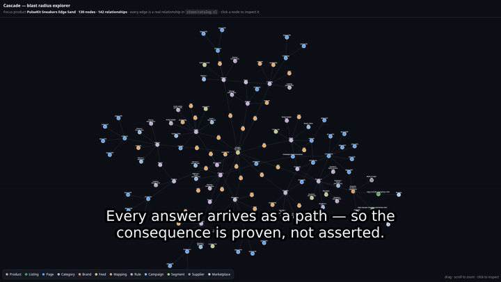

# Cascade

[](https://github.com/koztechie/cascade/actions/workflows/ci.yml)

**Know the blast radius before it breaks: one Cypher question returns a path through the graph — not a score.**

*Embedded and agent-native — **no signup, no server**: one deterministic,
inspectable file, and every answer is **connected context you can cite**.*

[](viewer.html)

*That is [`viewer.html`](viewer.html) above: **click a product**, and every edge
it touches lights up — brand, supplier, category, listings, feed contract — each
one a **real relationship** read from `store/catalog.rl`, not a mock-up.*
**Prefer to watch?** The **1:30 demo** — voice, subtitles, no login — is on
[YouTube](https://youtu.be/EuO9WT4_lPc).

**Explore in the browser, nothing to install** — `viewer.html` keeps that
literal: the graph is **pre-generated and offline**, so opening it needs no
server, no signup and no build step. It is an **equivalent way in**, not a
lesser one — the same edges the CLI and MCP serve, rendered for a person. A
**live** WASM-backed viewer (the catalog changing under you) is the planned
**M3** follow-up.

**New to graphs? Start here — look, run, ask.** Open [`viewer.html`](viewer.html)
(the GIF above is that screen), run `make verify`, then point any MCP client at
[`.mcp.json`](.mcp.json) and ask *"We are discontinuing PU-1004 — what breaks?"*.
*What you'll learn: what a blast radius is, why a path beats a score, and how to
read one without writing Cypher.*

**How it uses Relate, in one line:** one **single-file** store
(`store/catalog.rl`, 1.1 MB) behind the CLI, the Python client and **five
read-only MCP tools** — *why this mode*: that file **is** the whole database, so
anyone can inspect it, commit it and move it with nothing to stand up.
[Details below →](#how-it-uses-relate)

## Use case

E-commerce teams change something every week: a SKU is discontinued, a brand is
renamed, prices rise 10%, two categories merge. The blast radius of that one
change is scattered across product feeds, marketplace listings, price rules,
campaigns, landing pages and CRM segments — today it lives in spreadsheets and
tribal knowledge, and nobody finds the seventh consequence until it breaks.

**Who this is for:** the e-commerce **operations manager** who owns the weekly
change spreadsheet — SKU retired, price moved, categories merged — together
with marketplace/feed managers and the AI agents that assist them (the same
queries are served over MCP). The author runs these systems for a living, so
this is that weekly conversation, moved into a graph: you learn the seventh
consequence **before it breaks**, not on Friday in production.

### What a non-technical person sees

No Cypher required — the graph in business words: a **product** sits in a
**category**; it has **listings** on marketplaces; each **feed** demands
certain fields (a missing `gtin` gets a listing rejected); **rules** and
**campaigns** point at categories; **pages** link products and categories.
Change one product and the picture shows what else moves — highlighted, with
the reason beside each edge.

**Not a developer tool:** the deliverable is a sentence and a picture an
operations manager can act on — the Cypher underneath is the audit trail, not
the interface.

**The challenge names three audiences — "agents, apps, or people" — and
Cascade serves all three from the same graph:** the **agent**, over MCP with
five read-only tools; the **app**, as `viewer.html` and the one-line
`make report`; the **person** above, who never has to write Cypher. One store,
one set of paths, three ways in.

Cascade models that blast radius as a graph and answers, in one Cypher
statement each:

1. **What breaks** if we stop selling this product? → `queries/01_blast_radius.cypher`
2. **Why** is this listing rejected? → `queries/02_rejected_root_cause.cypher`
3. **What is invisible or unlinked** right now? → `queries/03_orphans.cypher`
4. **Dry run: what collides** if we merge category X into Y — rehearse the merge before you make it → `queries/04_merge_conflicts.cypher`
5. **Which products will be rejected next** (required field missing, found early)? → `queries/05_rejection_risk.cypher`
6. **Is this promo still in force?** — standing of every promo rule as of a fixed date → `queries/06_active_vs_expired.cypher`
7. **What single fix clears the most risk?** — remediation ranked by payoff → `queries/07_remediation.cypher`

Each check is **one Cypher file** — swap `$sku` / `$from` / `$to` to ask the
same questions of any product. Together they form a **verified query pack**:
`make verify` asserts the expected output of every one of them, so nothing in
this README is a hand-picked screenshot. Orphan pages and invisible stock are
edges that *should exist and don't* — **the missing link is the answer**.

Findings are **candidates for review, not verdicts**: an orphan page may be
deliberate, and a risk row is a prompt to fix the field — not a judgment on the
product. The graph also runs **without any AI account**: every query, the
report and the viewer work standalone; the MCP agent layer is optional.

**When this is the wrong tool:** when the graph has no edges for the question —
an **empty blast radius is not proof that a change is safe**, only that the
graph saw no connection. Cascade also has no history to query, no live
marketplace or CRM feeds, no semantic search, and one writer per store.
[The limits in full](#when-not-to-use-cascade).

## Why a graph — and why not a vector store

A vector store finds text that *looks like* the question; it cannot say **what
breaks**, because breakage lives in relationships that have to be traversed
(listing → product → category → feed contract → rule), not in similarity.
A graph answers with that traversal, and every answer arrives as a **path** —
so the consequence is proven, not asserted. That is also what separates this
from asking a model: the agent gets **connected context instead of a guess**,
and every sentence it says back can be checked against the edge that produced
it.

**Where this is different:** of the **60+ projects in this hackathon's
gallery, none works on catalog/feed operations** (every entry re-read on
23 Nov 2026, 67 in all). The "what breaks?" question is asked elsewhere too
(incidents, data lineage, code changes), but no entry points it at a product
catalog. Cascade points it where the answer costs money: listings, feeds,
rules, campaigns.

**The return:** **seven consequences instead of seven tables**, a **one-line
verdict** you can paste into a ticket, and the blast-radius query (475 rows)
runs in **206 ms** on a 2013 laptop — timings, and the machine they came from,
are in [The store in numbers](#the-store-in-numbers). The cost side is one
**1.1 MB** file: no server, no signup, no directory to reconcile.

**Cypher next to the SQL it replaces:** one pattern here, **ten tables** there —
the pattern, the join list and the recursive CTE are
[down in the technical details](#cypher-next-to-the-sql-it-replaces).

## The mental model

**An agent asks → five read-only MCP tools → the graph → an auditable path
comes back.** Nothing writes, nothing guesses: `read_cypher`, `get_schema`,
`blast_radius`, `rejection_causes`, `remediation`. **The path is the proof** —
not a confidence score, not a summary: a route through the graph you can open
in the viewer and run again yourself.

## What connects to what

- `Product` → `Listing` → `Marketplace` — where it is actually sold
- `Product` → `Category` → `Rule`, `Campaign`, `Segment` — the commercial machinery pointed at it
- `Category` → `Mapping` → `Feed` — the field contract each feed enforces (e.g. a required `gtin`)
- `Page` → `Product` / `Category` — what the site shows and links

The full node and relationship tables live under [How it uses Relate](#how-it-uses-relate).

## How it uses Relate

- **Mode:** single file (`store/catalog.rl`)
- **Why this mode:** one file *is* the whole database — judges can inspect it,
  commit it, move it, open it. No server, no directory to reconcile; the whole
  interface is `relate query --database store/catalog.rl`.
- **Portability:** that one file **carries the entire graph** — 1,667 nodes and
  3,730 relationships in 1.1 MB. Copy it, commit it, mail it, move it to
  another machine and the whole database travels with it: nothing to stand up,
  nothing to sync, nothing to sign up for.
- **What the graph models:**

  | Node | Meaning |
  | --- | --- |
  | `Product`, `Brand`, `Category`, `Supplier` | the catalog itself |
  | `Listing`, `Marketplace`, `Feed`, `Mapping` | where it is published and the field contract each feed enforces |
  | `Rule`, `Campaign`, `Segment` | the commercial machinery pointed at the catalog |
  | `Page` | landing/category/product pages on the site |

  | Relationship | Meaning |
  | --- | --- |
  | `IN_CATEGORY`, `HAS_BRAND`, `SUPPLIED_BY` | what a product is |
  | `OFFERS`, `PUBLISHED_ON` | where it is sold |
  | `HAS_MAPPING`, `APPLIES_TO` | which feed requires which field, for which category |
  | `TARGETS`, `FILTERS_BY` | which campaigns and segments touch which products |
  | `FEATURES`, `COVERS`, `LINKS_TO` | what the site shows and links |

Where the answer is a consequence, it arrives as a **path** — the route from
the change to the consequence, so the consequence is proven, not asserted.
Queries that check existence (`03`, `05`) report the objects themselves; every
*why*-question answers with a path.

## Run it in 60 seconds (what a judge can explore)

1. **Open [`viewer.html`](viewer.html)** — the demo blast radius, already
   built: offline, no server, **no query written**. That is your first
   insight. (`make viewer` rebuilds it.)
2. **Run `make verify`** — eleven gates, ending `== verify: OK ==` in **12–17 s**
   on the floor machine.

**What you'll see** — the real tail of that command, copied verbatim from a run
on this repo (the GIF above is what step 1 looks like):

```text
-- 11 generator determinism (byte-identical under PYTHONHASHSEED=1)
   OK: byte-identical under a different hash seed
normalize: store/catalog.rl already deterministic (3 shard ids)
== verify: OK ==
```

Then go deeper: `make report` (the one-line verdict, again no Cypher) ·
`make demo` (all seven queries) · ask an agent via [`.mcp.json`](.mcp.json) ·
read [`docs/agent-session.md`](docs/agent-session.md).

## For your agent

Relate states its own promise, as the hackathon page puts it: **"One command installs a
skill into the coding agents you already use, so they can find it and start
using it on their own."** Cascade ships that outcome as files already committed
here — [`.mcp.json`](.mcp.json) for any MCP client,
[`opencode.json`](opencode.json) for OpenCode, and
[`.agents/skills/cascade/SKILL.md`](.agents/skills/cascade/SKILL.md) for any
coding agent — so it **works with what you already use**: no new IDE, no new
account, no new workflow to learn.

The store serves MCP over stdio with five read-only tools — `read_cypher`,
`get_schema`, and the domain tools **`blast_radius(sku)`** (direct breakage +
category machinery + the bounded 4-hop neighbourhood, each layer labelled
honestly), **`rejection_causes`** (why listings are rejected, with the proof
path) and **`remediation`** (the one fix, ranked by payoff) — so an agent can
answer "what breaks?" with paths instead of guesses:

```bash
relate serve --mcp stdio --database store/catalog.rl --read-only
# on hardware the prebuilt CLI does not support:
./bin/relate serve --mcp stdio --database store/catalog.rl --read-only
```

**Read-only and bounded are a deliberate choice.** For an analytics tool,
refusing every write is a stronger guarantee than promising not to clobber:
`--read-only` makes the server refuse every write, so **it cannot delete
anyone's graph — including yours**, whatever an agent asks it to do.
`make verify` smoke-tests exactly that.

This repository ships a ready [.mcp.json](.mcp.json) — run your agent from
the repository root and it picks the graph up. For OpenCode there is also an
[`opencode.json`](opencode.json) in the repository root with the same server,
so the graph appears as `tools.cascade.*` without any manual wiring. A drop-in
agent skill at [`.agents/skills/cascade/SKILL.md`](.agents/skills/cascade/SKILL.md)
teaches any coding agent the five tools and the honesty rules before it writes
a single query (no rows → "no evidence in the graph"; every claim carries its
path). Then ask it: *"We are discontinuing PU-1004 — what breaks?"*

### Live excerpt (recorded 21 Nov 2026 — not scripted)

**You:** What breaks if we stop selling PU-1004?

**Agent** — calls `get_schema`, then writes its own Cypher:

```cypher
MATCH (l:Listing)-[:OFFERS]->(p:Product {sku: $sku})
RETURN l.id AS listing, l.platform AS platform, l.status AS status
ORDER BY l.platform
```

**Agent:**

> **Two listings stop being sold:** `L-0004-0` — Google Shopping (live) and
> `L-0004-1` — Rozetka (live). The product page `/p/pu-1004` becomes dead and
> `/c/sneakers` loses a position; Google Merchant Center's **required `gtin`
> contract** on the Sneakers category turns the delisting into a feed-vs-catalog
> mismatch. Attached machinery that loses this product: rules
> `Sneakers margin floor` + `Sneakers winter promo -15%`, campaigns
> `Sneakers / Viber` and `Sneakers / Email (SendPulse)`, segments
> `Sneakers viewers 30d` and `Win-back 180d` — **every claim a path in the graph**.

The full transcript — all five queries of scene 1 and scene 2 (rejection root
cause → `gtin` + `Listing → Product → Category → Mapping → Feed` path) —
lives in [`docs/agent-session.md`](docs/agent-session.md). `make verify`
smoke-tests this surface too, including that write attempts are refused.

### The shape of an agent-ready answer

A tool result an agent can quote without paraphrasing: the count first, the
rows under it, and an honest note when the answer is cut short. These are
**real responses** from the server above — `make verify` replays all of them
on every run.

**A count arrives with its rows:**

```json
{"row_count": 1, "rows": [{"c": 600}]}
```

**A big answer admits it instead of lying by omission** — 769 listings match,
200 come back (rows elided here):

```json
{"row_count": 769, "rows": [ … ], "truncated": true,
 "note": "truncated at 200 rows — narrow the query (add a WHERE or LIMIT)"}
```

**A write is refused in words, not silently:**

```json
{"content": [{"type": "text",
  "text": "Only read queries are allowed for read_cypher (got: CREATE). No write tool is exposed by this MCP server."}],
 "isError": true}
```

The domain tools answer the same way, with the claim labelled rather than
left to inference — `blast_radius("PU-1004")` returns `direct_breakage`
(2 listings, 1 page), `category_machinery`, the bounded 4-hop
`neighbourhood_4hops` and the line that keeps them apart: *"direct = real
breakage; neighbourhood = context, not breakage"*

## From an agent answer to a decision

One handover, three surfaces: the agent replies with a **path** → open
[`viewer.html`](viewer.html) to see that path highlighted in the graph → run
`make report` and paste its one-line verdict into the ticket. The terminal,
the browser and the ticket are the same answer in three forms — nobody has to
translate between them. And because `make report` writes **markdown**, the
report is portable too: paste the verdict, or attach the file, unchanged.

### The chain behind that decision: verdict → reason → path

Every answer here has the same three parts. The **verdict** is the one line
`make report` prints. The **reason** is the table beneath it — which objects,
and why. The **path** is the route through the graph that produced both, and
pasting the printed statement back into
`relate query --database store/catalog.rl --read-only` returns the same rows.

**Why exactly so** — the verdict is a chain, not an opinion: `PU-1004` carries
two `OFFERS` listings, so both stop being sold; the product page `FEATURES`
that SKU, so it dies with them; its category carries a required `gtin` mapping,
so the feed contract breaks. Every arrow above is an edge in the committed
store, which is why the same statement re-run returns the same rows.

**Risk → action, in the same document.** Section 4 of the report lists the
**47 products** that will fail the **next feed sync** (missing `gtin`); section
7 names the one fix — backfill `gtin` for those 47 — and what it clears: **67
feed risks**. The escalation trigger is not a judgement call: the report states
it as a deadline (*will fail the next feed sync*), so the reader knows both
what is at risk and what to do about it.

That is what lets a decision be audited later without trusting a summary: not
a note saying someone decided, but the inputs, the route and the output, still
reproducible from the committed store. What it deliberately is **not** is a
history of earlier decisions — the graph is current-state only
([`docs/limitations.md`](docs/limitations.md)): it records the catalog as it
stands, not the choices that shaped it.

## Evidence and engineering proof

Every number in this README comes from a run, not from typing — and each claim
traces back to the thing that produced it:

| Claim in this README | Where it is checked |
| --- | --- |
| What the seven queries return | `make verify` gates `01`–`04`, `06`, `08`, `09` assert the expected rows; `make golden` freezes the full output in `tests/golden/` |
| **Eleven gates** exist | `scripts/check_claims.sh` counts the gate markers inside `scripts/verify.sh`; a missing gate fails |
| **Five read-only tools**, by name | `check-claims` asks the live MCP server for `tools/list`; a rename or a sixth tool fails |
| **1,667** nodes · **3,730** relationships · **600 products** · **553** clean | `verify` gate `07` (self-grading against this README), reconciled by `check-claims` |
| **47** in the risk pool | 600 − 553, both figures asserted by gate `07` |
| Outputs cannot drift during a refactor | `make golden` compares the demo, report and verify output byte for byte with committed fixtures |
| `== verify: OK ==` in **12–17 s** · **206 ms** for the blast-radius query | measured on the 2013 AMD A4-4020 in [The store in numbers](#the-store-in-numbers) |
| A **one-line verdict** | the `**Verdict:**` line `make report` writes, frozen in `tests/golden/report.md` |
| Values stay values, not injected code | `verify` gate `10` passes an injection-like `sku` and requires no rows |
| The data is reproducible row for row | `verify` gate `11` regenerates under a different `PYTHONHASHSEED` and requires byte-identical output |
| What you cloned is what you ran | `make check-committed` opens the committed store **before** anything rebuilds it; CI asserts a clean working tree |
| The engine version cannot drift silently | `check-claims` compares the `Makefile` pin against `docs/versions.md` and the installed `.venv` |

`make verify` is the single entry point: committed-store precheck first, then
the eleven gates above, ending with `== verify: OK ==`. CI runs `verify`,
`golden` and `check-claims` on every push and pull request, so a green badge
means what a green local run means.

## When not to use Cascade

[`docs/limitations.md`](docs/limitations.md) is the full list, in the same
spirit as the Relate product's own limitations page. Condensed: the catalog is synthetic,
there are no live integrations, the seven queries are the product (anything
else needs an agent on top), blast radius stops at 4 hops, the graph is
current-state only, there is no semantic search, and Relate allows one writer
per store.

Two of those matter more than the rest:

- **No evidence means no rows.** When the graph has nothing to show for a
  question, Cascade reports insufficient evidence instead of inventing a
  confident conclusion.
- **Absence of impact is not proof of safety.** An empty blast radius means the
  graph saw no connection, not that the change is harmless — which is why
  query `03` exists, to print what the graph is missing rather than let
  silence reassure you.

Nothing here assumes a graph is always the right tool: if a relationship was
never recorded, no amount of traversal will produce it.

---

Technical details below: setup, data, numbers, mapping to the judging criteria.

## Setup and run

Prerequisites: Python 3.8+ and the `relate` binary (no server, no signup).

```bash
# 1. install relate — one binary
curl -sSfL https://relatedb.ai/install.sh | bash

# 2. clone this repository, then build the store and verify everything
git clone <this-repository>
cd cascade
make verify
```

`make verify` opens the **committed** store read-only first (a broken commit
must fail before anything rebuilds it), regenerates the synthetic catalog
(seed 42), rebuilds `store/catalog.rl`, and runs the eleven gates — each one
traced under [Evidence and engineering proof](#evidence-and-engineering-proof).
Expected output ends with `== verify: OK ==`; CI runs the same gates on every
push and pull request, so a green badge means what a green local run means.
`make report` writes the paste-into-a-ticket markdown report with its one-line
verdict; `make demo` runs all seven queries interactively.

If your CPU predates AVX2, the prebuilt binary refuses to start — that is
exactly the hardware this project is for. The repository ships `bin/relate`,
a wrapper that uses the official CLI when it runs on your machine and
otherwise drives the same engine through the embedded Python client
(`relate_db` on PyPI, installed into `.venv` by `make venv`, **pinned** —
see [`docs/versions.md`](docs/versions.md) for the version and the update
procedure): same commands,
same engine, same store file. `make verify` bootstraps whatever your machine
needs.

**Windows:** the wrapper is a shell script — run under **WSL or Git Bash**
(the official `relate` CLI itself supports Windows natively, but `make` and
`bin/relate` expect a POSIX shell). If Windows security blocks the unsigned
Relate binary (Smart App Control / SmartScreen), WSL sidesteps it — another
contestant hit exactly this and moved to WSL2.

Run the whole demo with recorded parameters:

```bash
make demo
```

Explore the store by hand:

```bash
relate query --database store/catalog.rl --read-only \
  "MATCH (n) RETURN labels(n)[0] AS label, count(*) AS n ORDER BY n DESC"
```

Keep it read-only: a read-write open makes the engine re-randomize the
store's shard ids, which would rewrite the file (any `make` target restores
the committed bytes — see `scripts/normalize_store.py`).

## Where the data lives

- `store/catalog.rl` — the persistent Relate store, committed to this repository.
- `data/load.cypher` — the generated load script (produced by
  `scripts/generate_data.py`, seed 42).
- `data/demo_params.json` — the demo SKU and category pair used by the queries.

The dataset is **synthetic**: realistic structure, deliberate defects, no real
business data — a public dataset of e-commerce *operations* does not exist, and
publishing a real catalog is not an option (see [`docs/limitations.md`](docs/limitations.md)).
The generator ships in this repository, so every row can be audited.

### Planted defects — check the claims

The dataset carries deliberate defects and `make verify` asserts them, so the
demo is falsifiable rather than hand-picked:

| Planted defect | Found by |
| --- | --- |
| Missing `gtin` on products → rejected listings + a live risk pool | queries `02`, `05` |
| Orphan pages nothing links to | query `03` |
| Active products with no listing and no page | query `03` |
| Two overlapping price rules on one category (Sneakers) | query `04` |
| An expired promo still sitting in the graph (Skincare) | query `06` |
| **Negative control:** the 553 products that carry `gtin` are never flagged (47 form the entire risk pool) | queries `05`, `07` |

## The store in numbers

| Metric | Value |
| --- | --- |
| Nodes | **1,667** — 600 products, 769 listings, 175 pages, 34 feed mappings, 38 rules/campaigns/segments, 51 catalog entities |
| Relationships | **3,730** |
| Store file | `store/catalog.rl` — **1.1 MB**, single file, committed |

Query timings, measured on a 2013 AMD A4-4020 without AVX2 — the floor, not
the ceiling:

| Query | Rows | Median |
| --- | --- | --- |
| 01 blast radius | 475 | 206 ms |
| 02 rejected root cause | 25 | 3.4 ms |
| 03 invisible inventory | 150 | 9.1 ms |
| 04 merge counterfactual | 15 | 1.2 ms |

## Cypher next to the SQL it replaces

Blast radius (query `01`) is a single variable-length pattern. The relational
equivalent joins the `Product`, `Listing`, `Marketplace`, `Feed`, `Mapping`,
`Category`, `Rule`, `Campaign`, `Page` and `Segment` tables with a recursive CTE
for the hops — **ten tables**. That gap is the whole argument for the graph,
stated as code rather than as a claim.

## How this maps to the judging criteria

- **Creativity** — an e-commerce *operations* change-impact graph: of the 60+
  entries in the gallery, none works on catalog/feed operations; the same
  "what breaks?" question is asked about incidents, data lineage and code
  changes, and this is the gallery entry that points it at a catalog.
- **Relate and connected context** — single-file store, seven Cypher checks,
  MCP with five read-only tools (`read_cypher`, `get_schema`, `blast_radius`,
  `rejection_causes`, `remediation`), every answer a traversal with the path as
  proof.
- **Functionality and completeness** — `make verify` runs eleven gates
  end-to-end from a fresh clone; `make report`, `make demo`, `viewer.html` and
  the committed store all work with no extra setup.
- **Usefulness** — the weekly spreadsheet conversation of every e-commerce
  operator, moved into a graph; the verdict is one line you can paste into a
  ticket.
- **Documentation and reproducibility** — this README; `docs/` (live agent
  transcript, submission-form inventory, competitor analysis, limitations);
  seed-42 generator; synthetic-data disclosure.

Built with AI assistance under the owner's direction — design, code, tests and
docs — while **no AI runs inside the product**: every runtime answer is
deterministic Cypher against the store, and where a model and the graph
disagree, the graph wins (`docs/limitations.md`).

**Licenses.** This repository is [MIT](LICENSE). Third-party: **cytoscape.js**
(MIT) is vendored in `vendor/`, its copyright notice kept intact inside the
file; **Relate** and the **`relate_db`** client are **Apache-2.0** and are
installed by you rather than vendored — no binary is redistributed here
(`bin/relate` is a wrapper script); the demo's voice is **Kokoro-82M**
(Apache-2.0). The viewer embeds **no font files** — it renders in system fonts.
The demo video, its music and the screenshots are this project's own work.

*Neo4j and Cypher are trademarks or registered trademarks of Neo4j, Inc. or
its subsidiaries in the United States and/or other countries. The names are
used here only to identify the product this project runs on.*

## Beyond one file

The Cypher here is standard: when a catalog outgrows a single process, the same
queries run on Neo4j / Neo4j Aura, and a subgraph can be pulled into Relay for
local work and pushed back — over **MCP, Bolt or HTTP**, the transports the
product exposes for exactly that. Nothing in Cascade needs rewriting to get
there; growing past one file is a change of address, not a rewrite.

## Use this template, add your case

The shape is deliberately generic: a committed store, eleven gates, a one-line
verdict, five read-only MCP tools. To point it at your own catalog, change the
generator (`scripts/generate_data.py`, seed 42) and `data/demo_params.json`,
then adjust the seven questions in `queries/` — each one a single statement you
can copy out on its own. The report is markdown, so your case ends up in a
ticket, a gist or a fork without reformatting anything.

The pattern is not ours alone. The official
[`jexp/relate-ideas`](https://github.com/jexp/relate-ideas) vault collects it as
**Code Graph** (*"what breaks if I delete this function?"*), **Dependency Radar**
and **blast radius**; Cascade is that same change-impact pattern applied to
**e-commerce catalog and feed operations** — a domain its examples do not cover.
If you build on this, a fork or an issue is what the licence is for.

### What we learned

- **A path beats a score.** A route someone can re-run from the committed store
  gets believed; a number they have to take on trust does not.
- **Freeze the output early.** Golden fixtures turned every later refactor into
  a one-command check instead of a judgement call.
- **Read-only is a feature.** Refusing every write is what made the agent
  surface safe to expose before any permissions story existed.
