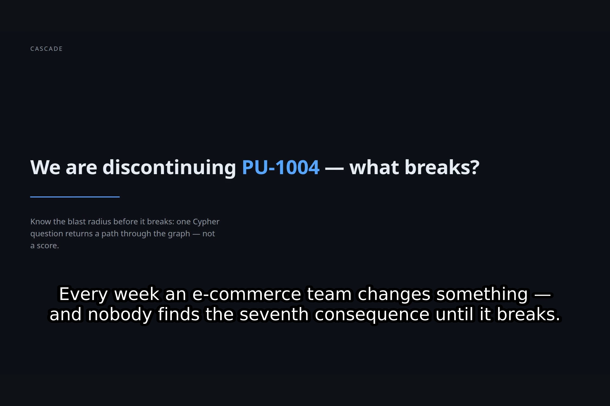
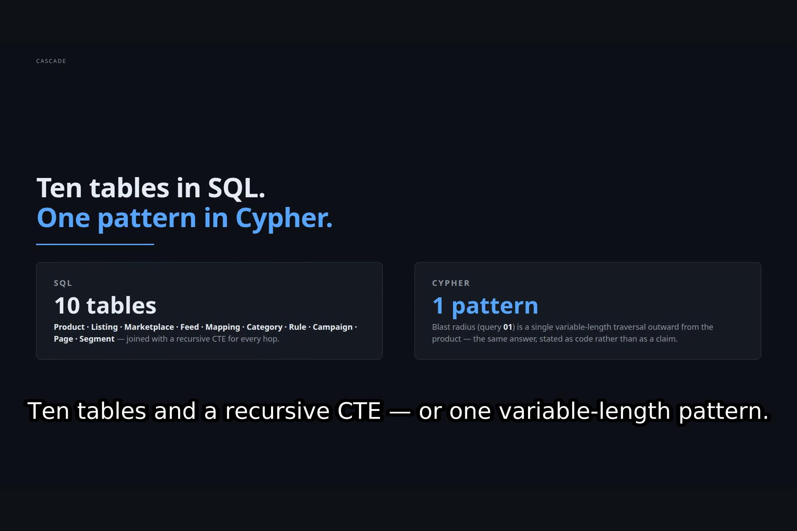
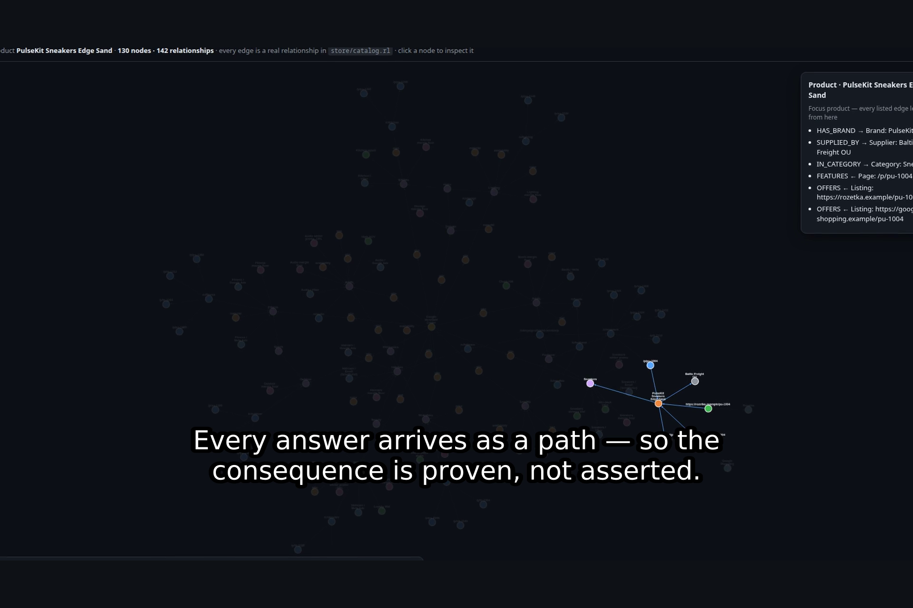
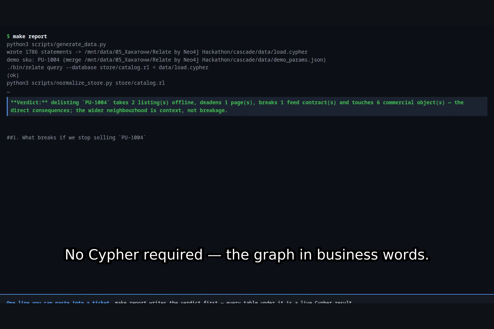
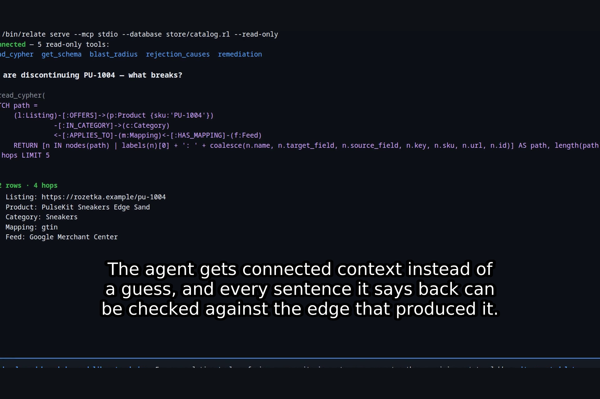
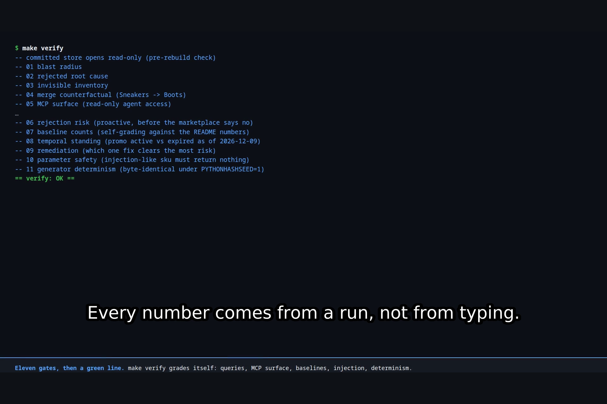
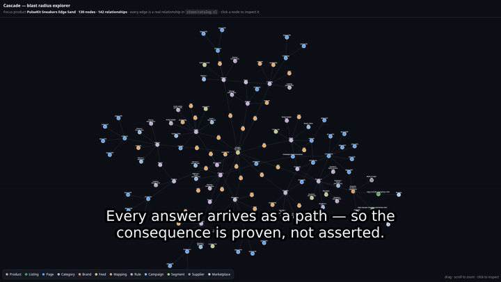

# dev.to article — готовий текст для публікації (крок 55)

**Стан:** чернетка готова **28.11.2026**, опублікувати **4–5.12** (за планом).
**Де публікувати:** dev.to → *Write a post* → вставити цей Markdown →4 теги → обкладинка `docs/devto-cover.png` (**1000×420**, зроблена 28.11) → *Publish*.
**Чому 4–5.12:** код уже заморожено (крок45), публікація напередодні вікна голосування; за R6 це **3-й кандидат на зріз** — якщо часу немає, ріжеться після GIF і5-го запиту.

**Теги (dev.to обмежує4):** `graphdatabase` · `cypher` · `neo4j` · `ai` (запасні: `mcp`, `llm`, `agents`)

**Зображення (додано 28.11) — усі вже вставлені в текст нижче** (посилання на `raw.githubusercontent.com`, тож у публікацію вставляється весь блок «Текст статті» цілком):
1. `docs/fig-question.png` → **після абзацу**, що починається *«Every week an e-commerce team changes something:…»* (вступ, одразу перед *«Why a spreadsheet cannot answer it.»*);
2. `docs/fig-sql.png` → **після абзацу «Why a spreadsheet cannot answer it.»** (закінчується *«…one variable-length pattern.»*);
3. `docs/fig-viewer.png` → **після абзацу** *«The store holds **1,667 nodes and 3,730 relationships** …»* (закінчується *«…clears the most risk.»*);
4. `docs/fig-verdict.png` → **після абзацу «The answer arrives as a path, not a score.»** (закінчується *«…live Cypher results.»*);
5. `docs/fig-agent.png` → **після абзацу «For agents, not just for people.»** (закінчується *«…including yours.»*);
6. `docs/fig-verify.png` → **після абзацу «What keeps it honest.»** (закінчується *«…rather than typed in.»*);
7. `video/viewer.gif` → **після абзацу** *«Then open `viewer.html` — …»* (тобто між ним і *«**Where this was written.**»*).
**Джерела1–6:** реальні кадри демовідео (ті самі, що в галереї Devpost, уже публічні). **Свідомо НЕ ввійшли:** `02-scale.png` (**475** — суперечить **476** у тексті) · `08-close.png` (дублює обкладинку). У частині від *«Where this was written.»* і до кінця картинок **немає — навмисно** (особистий текст лишається текстом).

---

## Екзистенційні елементи (додано 28.11) — джерела й межі

**Що увійшло в абзац «Where this was written» (усе — правдиве):**
- **Київ, ніч, перший коміт `6139b57` о 00:10**, **42 з 140 комітів** за перший день — звірено з git;
- сірий листопадовий дощ, **«без пальм»** — твої власні фрази з листування (*«Palm trees don't grow in Kyiv»*, *«the sky is always gray and cloudy»*);
- **нічні тривоги** як фон і привітання *«мирного неба»* — з твоїх задокументованих висловлювань (досьє, розділ здоров'я/контекст) + загальновідомий контекст;
- **статус із твоєї власної заяви** — `zayava_BPD_2026-11-26.html`: **внутрішньо переміщена особа** + **особа з інвалідністю III групи** + війна як реальність («ризики під час пересування містом») → спочатку в чернетці було *internally displaced person with a third-group disability*, **але при публікації 28.11 автор сам прибрав «internally displaced»** — у живому тексті: **a person with a third-group disability**; **без адреси, паспорта, телефону, e-mail, номера справи та деталей ТЦК/поліції**;
- **тіло й машина** — *«епізодичні спазми, слабкість, біль від погоди»* (досьє) і **старий компʼютер, що обмежує працю** (твоє формулювання 20.11) → *walking is hard* / *old enough to refuse heavy loads*;
- **госпіталізація** — твоє власне повідомлення в чаті *«Інна»* (**25.11, 10:14**: *«Привіт! В лікарні»*) + досьє (курс вдень-госпіталю, виписка 25.11) → речення *«There were hospital visits of my own in the middle of this build»*. **Без батька, без діагнозів, без ліків.**
- **повітряні тривоги, що переносять ранок** — з `TG/files/План.md` (твій власний операційний план від 22.11: *«загрозлива обстановка/тривога — виходити з запасом часу»*) → речення *«An air-raid alert moves a morning, a commute, a night's sleep»*. **З того самого плану НЕ взято:** ліки й дози, номер справи `К-3719/108`, бюджет/цінни сигарет, ім'я клієнта, прийоми в лікарів, статус ТЦК — усе це залишилось поза публікацією.
- **ставки** — твої датовані формулювання (досьє, 20.11 і 22.11): зламаний компʼютер сильно обмежує працю, а приз хакатону — **реальний шлях його замінити** → речення *«a real route out, not a fantasy»* і *«I did not enter to be voted for»* (**§9**: без жодних закликів голосувати чи «просити бали»).
- **два дослівні цитування твого власного ПУБЛІЧНОГО тексту** — твій артикл на dev.to *«One person, one project, one month: Building Svitlogics from Kyiv»* (12.07.2025): *«Because of my health, office life is impossible for me. So my home became my studio»* і *«a city that has learned to live by the sound of sirens»* → **звірив дослівно з оригіналом** (завантажив сторінку, `curl` 96 КБ) ✓; це твої власні раніше опубліковані слова, тож §9/§11 їх не зачіпають.

**Свідомо НЕ ввійшло:**
- **Чуже приватне** — тека `Тимчасове/TG` (перевірено **сім разів**, тека оновлювалась щоразу: чати *«Victoria»* → *«Лєна»* → *«Віка»* → *«Олександр»* → *«Інна»* → *«Ксюша»* (3 повідомлення, останній стан 14:55 — теки `files/` і `stickers/` зникли); **21 фото** — побут, київський двір, цінові таблиці, рамкова ПОДЯКА, стікер; голосове 51 с розпізнане **локально**, нікуди не відправлялось). Скан ключових слів: **війна 0 · інвалідність 0** у всьому; два збіги «втома» виявились підрядком слова *автоматично/автоматом*. Чужі обставини («difficult week», «new computer для кожного з нас», тиск «Розетки», **госпіталізація батька**) — **сторонні дані** (правила §11) → не публікуються.
- **Клінічні/юридичні деталі** — діагнози, ліки, паспорт/адреса/телефон, номер справи, обставини ТЦК і поліції, стосунки, гроші, чужі імена — **навіть попри наявність у досьє і в тій самій заяві**: публікації вони не потрібні, а ризик (незворотність публікації + активна юридична справа) великий.

**⚠️ Перед публікацією (4–5.12) — перечитай абзац сам:** це твоє життя, формулювання стиснуті мною. **Статус ВПО та III групу вже вкладено** — якщо хочеш прибрати, змінити чи додати власне речення (дослівно) — скажи, підправлю до публікації.

---

## Заголовок (варіанти)

1. **I stopped guessing what a product change breaks — and answered it with one Cypher question**
2. The blast radius of a product change, drawn as a path instead of a spreadsheet
3. What breaks if we stop selling this? A graph answer in 200 ms

## Текст статті

Every week an e-commerce team changes something: a SKU is retired, a brand is renamed, a category merge lands. The blast radius of that one change is scattered across product feeds, marketplace listings, price rules, campaigns, landing pages and CRM segments — and today it lives in a spreadsheet plus somebody's memory. Nobody finds the seventh consequence until it breaks.



**Why a spreadsheet cannot answer it.** The question is not "where did I write this down", it is "what is connected to this". A vector store finds text that *looks like* the question; it cannot say what breaks, because breakage lives in relationships that have to be traversed: listing → product → category → feed contract → rule. In SQL the same question is **ten tables** and a recursive CTE. In a graph it is one variable-length pattern.



**What I built: Cascade.** A change-impact graph for e-commerce operations, running on Relate as a **single file** — `store/catalog.rl`, 1.1 MB, committed to the repository. No server, no signup, no directory to reconcile: the whole interface is one command.

The store holds **1,667 nodes and 3,730 relationships** over a synthetic 600-product catalog (seed 42, generator included, deliberate defects planted so they can be asserted rather than assumed). Seven questions are answered by seven single statements — what breaks if we stop selling this product, why is this listing rejected, what is invisible right now, what collides if we merge two categories, which products get rejected next, is this promo still in force, and what single fix clears the most risk.



**The answer arrives as a path, not a score.** The blast-radius query returns **476 rows** in about **0.2 s** on a 2013 laptop without AVX2 — every row a route from the change to its consequence, so the claim is reproducible instead of asserted. `make report` opens with a one-line verdict you can paste into a ticket: delisting `PU-1004` takes 2 listings offline, deadens 1 page, breaks 1 feed contract. Under it, the tables are live Cypher results.



**For agents, not just for people.** The store serves MCP over stdio with five read-only tools — `read_cypher`, `get_schema`, `blast_radius`, `rejection_causes`, `remediation` — so an agent answers "what breaks?" with paths it can cite. The server refuses every write: it cannot delete anyone's graph, including yours.



**What keeps it honest.** `make verify` runs **eleven gates** end to end from a fresh clone in about **14 seconds**: committed store first, seven query results, the MCP surface with CLI/MCP parity, baseline counts, an injection test and a determinism check. `make golden` freezes demo, report and verify output byte for byte, CI re-runs all of it on every push, and every number in the README is checked against the store rather than typed in.



**What it is not.** No vector or hybrid retrieval, no live integrations, no production data — the catalog is synthetic and disclosed as such, because publishing a real one is not an option. Blast radius stops at four hops, and absence of impact is not proof of safety.

**Try it in sixty seconds:**

```bash
curl -sSfL https://relatedb.ai/install.sh | bash   # one binary
git clone https://github.com/koztechie/cascade.git
cd cascade && make verify                          # == verify: OK ==
```

Then open `viewer.html` — the blast radius is already built, offline, no query written — or give the repo to your agent through `.mcp.json`.



**Where this was written.** Kyiv, after midnight — the first commit in this repository is stamped **00:10**, and the day it was born carries **42 of its 140 commits**. November here supplies the framing for free: gray sky, rain, no palm trees, and nights that are not always quiet — which is why people here greet each other with *«мирного неба»*: a peaceful sky. An air-raid alert moves a morning, a commute, a night's sleep; you learn to plan the work around the sky rather than the clock.

I write this as a **person with a third-group disability**, on a machine old enough to refuse heavy loads, on days when walking is hard. None of that is a plea — it is the reason the tool asks as little as possible of whatever it runs on: **one file, no server, eleven gates in fourteen seconds, no cloud to depend on.** When the week around you is already unpredictable, knowing **exactly** what your next change touches stops being optimisation and becomes a small, readable piece of control.

**The week did not pause for it.** There were hospital visits of my own in the middle of this build, which is a second reason it had to stay small: small enough to finish on the days that are not good, and honest enough to trust on the ones that are.

**Most of this was written where I write everything else.** In my own earlier words: *«Because of my health, office life is impossible for me. So my home became my studio»* — in *«a city that has learned to live by the sound of sirens»*. So the answer here is built for exactly that studio: no server, no account, a graph in one file you can open locally, and a check you can run in fourteen seconds when the night is already long.

**Why this entry exists at all.** The machine I build on is failing, and it is the machine everything else in my life runs through — a new one is a real route out, not a fantasy. I did not enter to be voted for; I entered to show that a small, honest, verifiable answer is what careful work looks like when the tools are scarce.

**Links**

- Code: https://github.com/koztechie/cascade
- Demo, 1:30 with voice and subtitles: https://youtu.be/EuO9WT4_lPc
- Submission page: https://devpost.com/software/cascade-kys6m8

---

*Built with AI assistance under the owner's direction — design, code, tests and docs — while no AI runs at runtime: every answer is deterministic Cypher against the store. The narration voice in the demo video is AI-generated (Kokoro-82M, Apache-2.0), generated locally. Enter published as part of the Relate by Neo4j Hackathon.*
